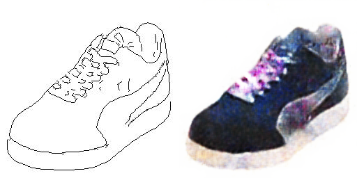

# pix2pix

Cycle-Consistent Adversarial Network (CycleGANs) is a method for image-to-image translation.

## Installation

```console
git clone https://github.com/bareform/dependencies.git
conda update -n base -c defaults conda
conda env create -f dependencies/environment.yml
conda activate bareform

git clone https://github.com/bareform/pix2pix.git
cd pix2pix
```

<details>
  <summary> Dependencies (click to expand) </summary>
  
  ## Dependencies
  - Python 3.10
  - datasets
  - numpy
  - torch
  - torchvision
    
</details>

## Quick Start

To train a low-precision `edges2shoes` pix2pix:

```
python3 -m utils.trainer --config="./configs/edges2shoes.toml"
```

After training for 25 epochs, you can find results similiar to the image at `./assets/edges2shoes/edges2shoes.png`:



You can download the pre-trained models [here](https://huggingface.co/luethan2025/pix2pix) and use the provided Jupyter Notebook `inference.ipynb` to generate some samples.

## Method

[Image-to-Image Translation with Conditional Adversarial Networks](https://arxiv.org/abs/1611.07004)

Phillip Isola, Jun-Yan Zhu, Tinghui Zhou, Alexei A. Efros

UC Berkeley

> We investigate conditional adversarial networks as a general-purpose solution to image-to-image translation problems. These networks not only learn the mapping from input image to output image, but also learn a loss function to train this mapping. This makes it possible to apply the same generic approach to problems that traditionally would require very different loss formulations. We demonstrate that this approach is effective at synthesizing photos from label maps, reconstructing objects from edge maps, and colorizing images, among other tasks. Indeed, since the release of the pix2pix software associated with this paper, a large number of internet users (many of them artists) have posted their own experiments with our system, further demonstrating its wide applicability and ease of adoption without the need for parameter tweaking. As a community, we no longer hand-engineer our mapping functions, and this work suggests we can achieve reasonable results without hand-engineering our loss functions either. 

## Citation

The original paper can be found at:
```
@misc{isola2016pix2pix,
    title={Image-to-Image Translation with Conditional Adversarial Networks},
    author={Phillip Isola and Jun-Yan Zhu and Tinghui Zhou and Alexei A. Efros},
    year={2016},
    eprint={1611.07004},
    archivePrefix={arXiv},
    primaryClass={cs.CV}
}
```
